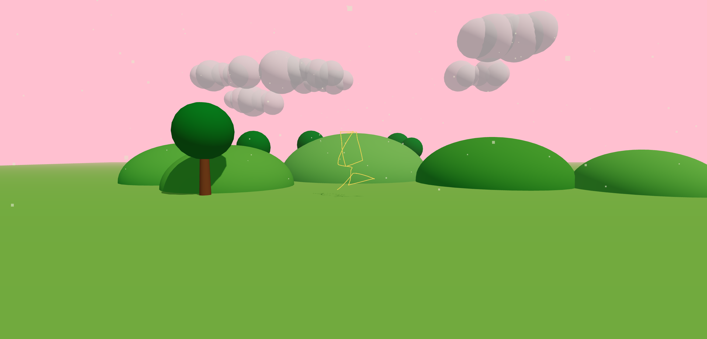

# Doodleverse: From Imagination to Interaction

<p align="center">
  
</p>

Doodleverse is a WebXR mixed reality experience for Meta Quest 3 that turns a drawing into a character you can play with. Draw on a virtual easel with your fingertips, wave a magic wand, and your doodle puffs up off the canvas, steps toward you, and opens a portal into a meadow world where you can play catch together.

**Live demo:** https://doodleverse-five.vercel.app

Built as a Semester 7 AR/VR project at MIT-WPU, for children aged 12+ (and adults too).

## Design principles

1. **Bare-hand input:** no controllers to learn.
2. **Instant magic:** the drawing becomes 3D the moment it's finished.
3. **No fail state:** free drawing and an easy reset.

## The experience

1. **Draw** on the easel with a fingertip or a held crayon (including a glowing neon crayon).
2. **Awaken** the drawing by waving the magic wand in a circle. It becomes a 2.5D character.
3. **Portal:** the room opens into a sky and island world.
4. **Play** fetch and catch with your character using a beach ball.
5. **Return** to drawing at any time.

It all runs in one continuous `immersive-ar` session with hand tracking, gaze-following hints, sparkles and spatial sound synthesised in code.

---

## Running Doodleverse

No build step: `index.html` loads three.js r170 from jsDelivr via an import map.

### Run on desktop (mouse preview)

```bash
python3 -m http.server 8000
```

Open http://localhost:8000 and press **Try a sample drawing**. Click a crayon or the eraser on the tray, then drag on the canvas. ⌘/Ctrl+Z undoes, C clears, Esc returns to the landing screen.

### Laptop tour (no headset)

Open the site on a laptop and press **Laptop tour (emulated headset)**. It loads Meta's [Immersive Web Emulation Runtime](https://github.com/meta-quest/immersive-web-emulation-runtime) (`iwer`, pinned to 2.5.0) as an emulated Quest 3 with tracked hands, plus a synthetic living room (`@iwer/sem`) standing in for passthrough, then enters the real WebXR session: the same hand tracking, pinches, gaze guide, sparkles and spatial sound as on a headset. `tour/TourControls.js` steers the emulated head and hands:

| Control | Does |
|---|---|
| Mouse | moves your right index fingertip (it hovers just in front of whatever is under the pointer) |
| Click / drag | touch: draw on the board, press buttons, tap crayons |
| Space (or right button) | pinch: pick up a crayon, the wand, the board handle or the ball; let go to drop or throw. Pointed at something far away (the red diamond), it's a point-and-pinch |
| Shift | both hands, either side of the pointer: carry your friend (Shift+Space), catch the ball |
| W A S D | walk |
| Arrow keys, or Alt + mouse | look around |
| Q / E | crouch / stand (to reach the basket) |
| Esc | leave the tour |

A controls card sits in the bottom-right corner during the tour. Add `?tour` to the URL to show the tour button even where real WebXR is available.

### Run on Meta Quest

WebXR needs a secure context; `localhost` counts, so forward the port over USB instead of setting up HTTPS:

```bash
adb reverse tcp:8000 tcp:8000
```

Then open http://localhost:8000 in the Quest browser and press **Enter Doodleverse**.

- The canvas appears in front of you, a little below eye level. Hold the Meta button to re-centre it.
- **Hold your tools:** pinch a crayon to pick it up and draw with its tip; pinch the eraser and rub to erase. Let go and they float back to the tray. Tapping still just chooses a tool for your finger.
- **Point from afar:** aim at a crayon, the eraser or a button and a yellow ray appears; do the system pinch to choose or press it.
- **Never lost:** a small sign follows your gaze with what to do next. If the board (or later your friend) is out of view, it says so and an arrow points the way. If your friend stays out of view for 4 seconds, it hops back in front of you.
- **Move the board:** pinch the grey handle under the tray and move your hand; the board follows and turns to face you. (On desktop, drag the handle.)
- **Neon crayon:** the glowing purple crayon draws with light. In the desktop preview it blooms (selective `UnrealBloomPass` via `EffectComposer`); WebXR can't run three.js post-processing, so in the headset neon strokes get a soft additive halo instead. Neon parts stay glowing on the character.
- **Magic effects:** the waving wand leaves a trail of glowing star sparkles, and a burst of sparkles in the drawing's colours flies out of the canvas as it comes to life (`vfx/Sparkles.js`).
- **Spatial sound:** every sound is a `PositionalAudio` on the object that makes it, synthesised in code (`audio/Sfx.js`, no audio files): the wand shimmers louder and higher the faster you swirl, the ball goes "boing" on the floor, the character "pops" when it catches the ball, and it babbles cute gibberish now and then. Sound starts after your first tap or click (a browser rule).
- **Bring it to life:** pinch the magic wand off the tray and wave it in a circle. The star glows and spins faster as it charges. The green Done button does it in one tap. (On desktop, drag the wand in circles.)
- A **How to Draw** card floats to the left of the board while drawing (an HTML card on desktop and phones).
- To leave the Doodleverse while drawing, poke the red **Exit** button at the board's top-right corner, then poke it again to confirm (it resets after 3 seconds).
- Tap a crayon or the eraser on the tray to pick it.
- Touch the canvas with your index finger to draw. The ring on the canvas shows where you'll land; it shrinks as you get closer.

- Tap the **magic wand** at the right end of the tray to bring the drawing to life. It puffs up out of the canvas and steps toward you, then the world opens around you. (On desktop, use **Bring to life** / **Draw again** in the top bar.)

- The green **Done** sphere next to the crayons does the same as the wand.
- Once the character has stepped off the canvas, pinch it with **both hands** to pick it up. Let go while moving to throw it. It bounces, does two happy hops, and hops back toward you if it lands more than 2.5 m away. (On desktop, drag it with the mouse.)
- While holding it, flick your hands up quickly and it leaps out of them. It watches your head, or a hand that comes within 60 cm.
- **Play catch:** when the world opens, a basket with a beach ball sits on the floor to the right of the canvas. Pinch the ball with one hand, throw it to the character, and it catches it and lobs it back to just in front of you. A ball left more than 3 m away goes back to the basket after a few seconds, and so does one dropped into it. (On desktop, drag the ball with the mouse.)
- **Fetch:** whenever you throw the ball, the character hops after it (jumping up if the ball is just overhead), catches it, and throws it back to you.
- **Missed it?** If you don't catch the throw-back, the ball lands and hops back into the basket by itself.
- **Tidy up:** pick the ball up off the floor and hold it over the basket. The rim glows green; let go and it drops in (the character leaves it alone).
- A live hint sign over the basket always says what to do next.
- **Catch it back:** bring both hands together (palms within 30 cm) where the ball is arriving and it settles between them. Pinch it to pick it up; move your hands apart to drop it.
- **Exit:** a red diamond floats above the canvas. Point at it (it glows) and pinch to go back to drawing. This uses WebXR's select event, so it works with hands or controllers. On desktop, click it.
- A **How to Play** card and a **Back to Drawing** button float to the left of the canvas once it wakes (poke the button). On desktop and phone AR they're HTML instead.

Live at https://doodleverse-five.vercel.app. To redeploy, copy the app files into `doodleverse/` and run `npx vercel deploy --prod` there.

Every finished stroke lives in `window.doodleverse.strokes` (canvas-local `points`, `color`, the smoothed `curve`, and the scene `object`).

### Layout

- `index.html`: 2D landing screen (HTML/CSS, only visible outside the headset) and the desktop HUD
- `app.js`: session, canvas placement, hand tracking, drawing and erasing
- `awakening/buildCharacter.js`: Phase 2, strokes → extruded 2.5D character
- `portal/Portal.js`: Phase 3, the expanding sky/island world and particle burst
- `easing.js`: shared easing curves
- `ui/ArtTray.js`: crayons, eraser and magic wand, with tap hit-testing
- `ui/GlowFrame.js`: shader-based glowing dashed border around the canvas (animate it for the portal)
- `ui/SpatialPanel.js`: canvas-texture floating panel for all in-headset UI
- `vfx/`: sparkle particles, neon ink helpers and the desktop bloom renderer
- `audio/Sfx.js`: synthesised spatial sound effects
- `tour/TourControls.js`: mouse-and-keyboard steering for the emulated headset in the laptop tour
- `sampleDoodle.js`: the sample cloud drawing

## Author

Turiya Joshi
